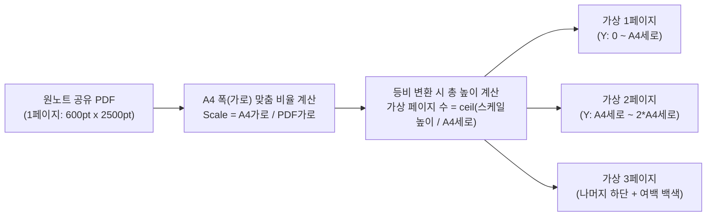

# OneNote 인쇄 및 PDF 공유 출력 문제점 원인 분석 및 종합 개선 방안

> **대상 프로젝트**: [`samsung_m2070_printer`](file:///D:/My%20Documents/AI/samsung_m2070_printer)
> **목적**: 안드로이드 원노트(OneNote) 앱에서 프린트 메뉴 부재 및 `[PDF로 공유]` 시 발생하는 4가지 핵심 문제(어두운 테마 검은 배경 토너 낭비, 레이아웃 왜곡, 다중 페이지 미분할, 프리뷰 확대/축소 불가)의 기술적 원인을 규명하고, 우리 프린팅 앱(`M2070 Direct Print`)에서 이를 완벽히 해결하기 위한 구현 명세서입니다.

---

## 0. 왜 안드로이드 원노트에는 `[인쇄]` 메뉴가 보이지 않는가?

- **원인**: Microsoft OneNote 안드로이드 앱은 무한 캔버스(Infinite Canvas) 구조를 채택하고 있어, Word/Excel 모바일 앱과 달리 자체 메뉴에 안드로이드 시스템 인쇄(`PrintManager`)를 호출하는 **`[인쇄]` 버튼을 아예 제공하지 않습니다.** 오직 **`[페이지 공유]` ➔ `[PDF로 공유]`** 또는 **`[일반 텍스트로 공유]`**만 제공합니다.
- **원노트 `[PDF로 공유]`의 치명적 한계**:
  1. **무한 캔버스 통짜 PDF 생성**: 원노트 모바일은 노트를 A4 크기로 나누지 않고, 작성된 전체 노트 길이만큼 **세로로 엄청나게 긴 1장의 단일 커스텀 크기 PDF 페이지**(예: 폭 595pt × 높이 3,500pt)로 내보냅니다.
  2. **다크 모드 배경색 하드코딩**: 원노트가 어두운 테마(Dark Mode)일 때 PDF로 공유하면, PDF 페이지 배경에 검은색/짙은 회색(`#1E1E1E` 등) 직사각형이 그대로 그려진 채 내보내집니다.

이 두 가지 원노트 자체 특성 위에 현재 우리 앱([`MainActivity.kt`](file:///D:/My%20Documents/AI/samsung_m2070_printer/android/app/src/main/kotlin/com/antigravity/samsung_m2070_printer/MainActivity.kt))의 `PdfRenderer` 렌더링 방식이 맞물리면서 말씀하신 4가지 현상이 발생하고 있습니다.

---

## 1. 4대 문제점의 코드 레벨 원인 진단

| 번호 | 현상 | 현재 코드의 직접적 원인 | 관련 코드 위치 |
| :--- | :--- | :--- | :--- |
| **문제 1** | **어두운 테마일 때 배경이 검은색으로 출력되어 토너 낭비** | 원노트 다크모드 PDF는 배경 픽셀 자체가 어두운 색(`lum < 128`)이고 글자가 밝은 색(`lum >= 128`)입니다. 현재 C++ 인코더는 어두운 픽셀을 무조건 토너(`1`)로 변환하므로 용지 전체에 검은 토너를 쏟아붓게 됩니다. | [`qpdl_encoder.cpp`](file:///D:/My%20Documents/AI/samsung_m2070_printer/android/app/src/main/cpp/qpdl_encoder.cpp#L353-L415) (`convertArgbToMono`) |
| **문제 2** | **PC 원노트와 달리 폰트·크기·문단 비율이 완전히 찌그러져 이상함** | `page.render(bitmap, null, null, ...)` 호출 시 `destClip`과 `transform` 행렬에 `null`을 전달하고 있습니다. `PdfRenderer`는 `transform == null`이면 **원본 PDF의 가로·세로 비율을 무시하고 타겟 비트맵(A4 비율 1:1.414)에 강제로 늘려서(Stretch) 채웁니다.** 즉, 세로로 4배 긴 원노트 PDF가 세로로 1/4로 납작하게 눌리거나 가로가 기형적으로 변형됩니다. | [`MainActivity.kt`](file:///D:/My%20Documents/AI/samsung_m2070_printer/android/app/src/main/kotlin/com/antigravity/samsung_m2070_printer/MainActivity.kt#L128) 및 [`L194`](file:///D:/My%20Documents/AI/samsung_m2070_printer/android/app/src/main/kotlin/com/antigravity/samsung_m2070_printer/MainActivity.kt#L194) |
| **문제 3** | **내용이 많아 여러 장이어야 하는데 프리뷰에 1장밖에 안 보임** | 원노트가 세로로 긴 **단일 페이지(1 Page) PDF**를 생성했기 때문에 `renderer.pageCount`가 `1`을 반환합니다. 이를 A4 폭 기준으로 비례 축소 후 세로 높이에 맞춰 **자동 다중 페이지 분할(Auto-Tiling / Pagination)** 해주는 로직이 없습니다. | [`MainActivity.kt`](file:///D:/My%20Documents/AI/samsung_m2070_printer/android/app/src/main/kotlin/com/antigravity/samsung_m2070_printer/MainActivity.kt#L96-L98) |
| **문제 4** | **프리뷰 확대/축소가 안 되어 보기가 불편함** | 프리뷰 위젯이 높이 `280px` 고정 `Container` 안에 단순 `Image.memory`로만 들어있어 핀치 줌(Pinch-to-Zoom), 패닝(이동), 전체화면 보기가 불가능합니다. | [`pdf_preview_card.dart`](file:///D:/My%20Documents/AI/samsung_m2070_printer/lib/ui/widgets/pdf_preview_card.dart#L55-L73) |

---

## 2. 문제별 상세 개선 방안

### ✅ 개선 1: 다크 모드 자동 감지 및 스마트 색상 반전 (토너 절약 모드)

원노트 다크 테마에서 넘어온 문서를 프리뷰와 인쇄물 모두에서 **하얀 종이 배경 + 검은 글씨**로 깨끗하게 변환합니다.

#### 1) 작동 원리 (Smart Dark-Page Inversion)
1. **자동 감지(Auto-Detect)**: 렌더링된 페이지 비트맵의 테두리 및 전체 픽셀을 샘플링하여 **어두운 픽셀(`luminance < 85`)의 비율이 전체 면적의 50%를 초과**하면 "다크 테마 문서"로 판정합니다.
2. **색상 반전 + 배경 화이트 클리핑**:
   - 단순 RGB 반전(`255 - lum`)만 하면 원노트의 짙은 회색 배경(`#1E1E1E`, 밝기 30)이 밝은 회색(`#E1E1E1`, 밝기 225)이 되어 디더링(Dithering) 시 종이 전체에 미세한 회색 점(토너)이 찍힙니다.
   - 따라서 반전 후 **밝기가 일정 임계값(예: `lum > 200`) 이상인 어두운 배경 영역은 완전한 순백색(`255, Color.WHITE`)으로 클리핑(White Clipping)**하고, 글자(밝은 색이었던 부분)는 선명한 검은색으로 대비(Contrast)를 높입니다.
3. **UI 옵션 제공**: [`ConfigPanel`](file:///D:/My%20Documents/AI/samsung_m2070_printer/lib/ui/widgets/config_panel.dart)에 **`다크 테마 배경 반전 (토너 절약)`** 옵션(`자동 감지 [기본값]` / `항상 반전` / `끄기`)을 추가하고, 프리뷰 이미지에도 즉시 반영하여 눈으로 결과를 확인하게 합니다.

#### 2) 구현 코드 예시 (Kotlin 비트맵 후처리 함수)
```kotlin
/**
 * 다크 모드(어두운 배경) 비트맵을 감지하여 흰 배경 + 검은 글씨로 스마트 반전합니다.
 */
fun applySmartDarkThemeInversion(bitmap: Bitmap, forceInvert: Boolean = false) {
    val width = bitmap.width
    val height = bitmap.height
    val pixels = IntArray(width * height)
    bitmap.getPixels(pixels, 0, width, 0, 0, width, height)

    // 1. 어두운 배경인지 샘플링 검사 (forceInvert가 아닐 때)
    if (!forceInvert) {
        var darkCount = 0
        var sampleCount = 0
        val step = maxOf(1, (width * height) / 10000) // 약 10,000개 픽셀 고속 샘플링
        for (i in pixels.indices step step) {
            val c = pixels[i]
            val lum = (Color.red(c) * 77 + Color.green(c) * 150 + Color.blue(c) * 29) shr 8
            if (lum < 85) darkCount++
            sampleCount++
        }
        // 어두운 픽셀이 50% 미만이면 일반(밝은 배경) 문서이므로 그대로 유지
        if (darkCount * 2 < sampleCount) return
    }

    // 2. 색상 반전 및 배경 순백색(White) 클리핑 (토너 낭비 원천 차단)
    for (i in pixels.indices) {
        val c = pixels[i]
        val r = 255 - Color.red(c)
        val g = 255 - Color.green(c)
        val b = 255 - Color.blue(c)
        val invLum = (r * 77 + g * 150 + b * 29) shr 8

        // 원래 다크모드 배경이었던 영역(반전 후 밝기 190 이상)은 완전 백색(#FFFFFF)으로 고정
        if (invLum >= 190) {
            pixels[i] = Color.WHITE
        } else {
            // 글자 및 선 영역은 가독성을 위해 어둡게 대비 강화
            val darkened = (invLum * 0.7f).toInt().coerceIn(0, 255)
            pixels[i] = Color.rgb(darkened, darkened, darkened)
        }
    }
    bitmap.setPixels(pixels, 0, width, 0, 0, width, height)
}
```

---

### ✅ 개선 2 & 3: A4 비율 유지 렌더링(Matrix) 및 긴 원노트 페이지 자동 다중 분할(Pagination)

**문제 2(폰트/문단 찌그러짐)**와 **문제 3(긴 내용이 1장으로만 보이는 현상)**은 동일한 근본 원인에서 비롯되므로 **가상 A4 페이지 분할 엔진(Virtual A4 Paginator)**으로 동시에 해결합니다.

#### 1) 왜 지금 모양이 이상하고 1장만 나오는가?
- 현재 코드는 원본 PDF 페이지의 폭(`page.width`)과 높이(`page.height`)를 전혀 확인하지 않고 `page.render(bitmap, null, null, ...)`을 호출합니다.
- 예를 들어 원노트에서 3페이지 분량의 필기를 공유하면 원본 PDF는 **1페이지(폭 600pt × 높이 2,500pt)**입니다.
- 이를 A4 비트맵(폭 4960 × 높이 7016)에 `transform = null`로 그리면, 가로는 8.26배 늘어나는데 세로는 2.8배밖에 안 늘어나 **글자가 위아래로 3배나 납작하게 눌린 기형적인 1장**이 됩니다.

#### 2) 해결 설계: 폭 기준 등비 스케일링 + 세로 자동 슬라이싱 (Virtual Pages)


1. **여백(Margin) 확보**: PC 원노트처럼 종이 가장자리에 깔끔한 여백(상하좌우 약 5mm~10mm)을 두어 글자가 잘리지 않게 합니다.
2. **가로/세로 비율 100% 고정 (`android.graphics.Matrix`)**:
   - 항상 **가로 폭(`scale = printableWidth / pdfPage.width`)을 기준으로 가로·세로에 동일한 스케일(`setScale(scale, scale)`)**을 적용합니다. 이렇게 하면 폰트 모양, 글자 크기, 문단 간격이 PC 원노트와 완전히 동일한 정비율로 유지됩니다.
3. **자동 다중 페이지 분할 (Tall Page Slicing)**:
   - 스케일링된 PDF 페이지의 높이(`scaledHeight = pdfPage.height * scale`)가 A4 인쇄 가능 높이(`printableHeight`)보다 길면(예: `scaledHeight > printableHeight * 1.08`), 이를 여러 개의 **가상 페이지(Virtual PageSlice)**로 자동 분할합니다.
   - 각 슬라이스를 렌더링할 때는 `Matrix.postTranslate(marginLeft, marginTop - sliceIndex * printableHeight)`를 적용하여 정확히 해당 구간의 내용만 A4 용지에 그립니다.
   - 이렇게 하면 원노트가 1장짜리 긴 PDF를 보내더라도, 우리 앱에서는 **"총 4 페이지"**로 인식하여 프리뷰에서도 1~4페이지를 넘겨볼 수 있고, 인쇄 시에도 4장의 A4 용지에 나누어 출력됩니다!

#### 3) 구현 코드 예시 (`MainActivity.kt` 내 슬라이스 계산 및 Matrix 렌더링)
```kotlin
data class VirtualPageSlice(
    val pdfPageIndex: Int, // 원본 PDF의 페이지 번호
    val sliceIndex: Int,   // 분할된 조각 번호 (0, 1, 2...)
    val totalSlices: Int   // 해당 원본 페이지가 몇 장으로 나뉘었는지
)

/**
 * 원본 PDF의 모든 페이지를 검사하여, 세로로 긴 원노트 페이지를 A4 비율에 맞게 다중 가상 페이지로 매핑합니다.
 */
private fun buildVirtualPageList(renderer: PdfRenderer): List<VirtualPageSlice> {
    val slices = mutableListOf<VirtualPageSlice>()
    val a4Aspect = 7016f / 4960f // 1.4145 (A4 세로/가로 비율)

    for (i in 0 until renderer.pageCount) {
        val page = renderer.openPage(i)
        val w = page.width.toFloat().coerceAtLeast(1f)
        val h = page.height.toFloat().coerceAtLeast(1f)
        page.close()

        // 가로 폭을 A4에 맞췄을 때 세로 비율 계산
        val pageAspect = h / w
        // A4 비율보다 10% 이상 더 긴 경우에만 여러 장으로 분할 (미세한 오차로 빈 페이지가 생기는 것 방지)
        val sliceCount = if (pageAspect > a4Aspect * 1.10f) {
            kotlin.math.ceil(pageAspect / a4Aspect).toInt()
        } else {
            1
        }

        for (s in 0 until sliceCount) {
            slices.add(VirtualPageSlice(pdfPageIndex = i, sliceIndex = s, totalSlices = sliceCount))
        }
    }
    return slices
}

/**
 * 특정 가상 페이지를 가로/세로 정비율(Matrix)을 유지한 채 비트맵에 렌더링합니다.
 */
private fun renderVirtualPage(
    renderer: PdfRenderer,
    slice: VirtualPageSlice,
    targetWidth: Int,
    targetHeight: Int,
    forPrint: Boolean
): Bitmap {
    val page = renderer.openPage(slice.pdfPageIndex)
    val bitmap = Bitmap.createBitmap(targetWidth, targetHeight, Bitmap.Config.ARGB_8888)
    val canvas = Canvas(bitmap)
    canvas.drawColor(Color.WHITE)

    // 상하좌우 3% 여백 적용 (PC 원노트 인쇄 여백 효과)
    val marginX = targetWidth * 0.03f
    val marginY = targetHeight * 0.03f
    val printableW = targetWidth - (marginX * 2)
    val printableH = targetHeight - (marginY * 2)

    // 가로 폭 기준 등비율 스케일 (절대 가로/세로 비율을 다르게 주지 않음 -> 폰트 왜곡 완벽 방지)
    val scale = if (slice.totalSlices == 1) {
        // 1장 이내인 경우: 가로/세로 중 작은 쪽에 맞춰 중앙 정렬(Fit) 또는 가로 맞춤
        minOf(printableW / page.width.toFloat(), printableH / page.height.toFloat())
    } else {
        // 여러 장으로 나뉘는 긴 원노트 문서: 가로 폭을 A4 인쇄 폭에 맞춤
        printableW / page.width.toFloat()
    }

    // 현재 슬라이스의 Y 오프셋 이동
    val translateX = marginX
    val translateY = marginY - (slice.sliceIndex * printableH)

    val matrix = android.graphics.Matrix().apply {
        setScale(scale, scale)
        postTranslate(translateX, translateY)
    }

    // 상하 여백 영역에 이전/다음 페이지 글자가 침범하지 않도록 클리핑 영역 지정
    val clipRect = android.graphics.Rect(
        marginX.toInt(),
        marginY.toInt(),
        (targetWidth - marginX).toInt(),
        (targetHeight - marginY).toInt()
    )

    val mode = if (forPrint) PdfRenderer.Page.RENDER_MODE_FOR_PRINT else PdfRenderer.Page.RENDER_MODE_FOR_DISPLAY
    page.render(bitmap, clipRect, matrix, mode)
    page.close()

    return bitmap
}
```

> [!TIP]
> **추가 팁 (PC 원노트와 가장 유사한 문단 레이아웃을 원할 때)**:
> 원노트 앱에서 노트를 작성할 때 한 줄을 오른쪽으로 너무 길게 쓰면 A4 폭에 맞출 때 글씨가 작아질 수 있습니다. 만약 텍스트 위주의 노트라면 원노트 공유 메뉴에서 **`[일반 텍스트로 공유]`**를 우리 앱이 받아서 A4 폭에 맞게 자동 줄바꿈(Reflow)하여 출력하는 기능도 함께 지원하면 긴 문단도 PC처럼 깔끔하게 줄바꿈됩니다.

---

### ✅ 개선 4: 고해상도 프리뷰 및 핀치 줌(확대/축소) + 전체화면 뷰어 지원

현재 프리뷰가 작고 흐릿하며 확대가 안 되는 문제를 해결합니다.

#### 1) 프리뷰 해상도 상향
- 현재 [`NativePrintService.renderPagePreview`](file:///D:/My%20Documents/AI/samsung_m2070_printer/lib/services/native_print_service.dart#L36)의 기본 해상도가 `595 x 842`(72 DPI 수준)로 되어 있어 확대하면 글자가 깨집니다.
- 이를 **`1190 x 1684` (약 150 DPI)**로 2배 상향하여 확대했을 때도 작은 글씨까지 선명하게 보이도록 합니다.

#### 2) `InteractiveViewer` 적용 및 전체화면 모달 뷰어 추가 ([`pdf_preview_card.dart`](file:///D:/My%20Documents/AI/samsung_m2070_printer/lib/ui/widgets/pdf_preview_card.dart))
- Flutter 기본 제공 위젯인 **`InteractiveViewer`**로 이미지를 감싸 **두 손가락 핀치 줌(최대 5배 확대), 드래그 이동, 더블탭 확대/원복**을 지원합니다.
- 카드 높이를 기존 `280px`에서 `420px`로 넓히고, 우측 상단에 **`[전체화면 크게 보기]`(`Icons.fullscreen`)** 버튼과 **`[배경 반전 토글]`** 버튼을 배치합니다.

#### 3) 구현 코드 예시 (`lib/ui/widgets/pdf_preview_card.dart`)
```dart
class PdfPreviewCard extends StatefulWidget {
  final int currentPage;
  final int totalPages;
  final Uint8List? previewImageBytes;
  final bool isLoading;
  final ValueChanged<int> onPageChanged;

  const PdfPreviewCard({
    super.key,
    required this.currentPage,
    required this.totalPages,
    required this.previewImageBytes,
    required this.isLoading,
    required this.onPageChanged,
  });

  @override
  State<PdfPreviewCard> createState() => _PdfPreviewCardState();
}

class _PdfPreviewCardState extends State<PdfPreviewCard> {
  final TransformationController _zoomController = TransformationController();

  void _resetZoom() {
    _zoomController.value = Matrix4.identity();
  }

  void _openFullScreenPreview(BuildContext context) {
    if (widget.previewImageBytes == null) return;
    showDialog(
      context: context,
      builder: (ctx) => Dialog.fullscreen(
        backgroundColor: Colors.black87,
        child: Scaffold(
          backgroundColor: Colors.black87,
          appBar: AppBar(
            backgroundColor: Colors.black,
            foregroundColor: Colors.white,
            title: Text("페이지 ${widget.currentPage + 1} / ${widget.totalPages}"),
            actions: [
              IconButton(
                icon: const Icon(Icons.chevron_left),
                onPressed: widget.currentPage > 0
                    ? () {
                        Navigator.pop(ctx);
                        widget.onPageChanged(widget.currentPage - 1);
                      }
                    : null,
              ),
              IconButton(
                icon: const Icon(Icons.chevron_right),
                onPressed: widget.currentPage < widget.totalPages - 1
                    ? () {
                        Navigator.pop(ctx);
                        widget.onPageChanged(widget.currentPage + 1);
                      }
                    : null,
              ),
            ],
          ),
          body: InteractiveViewer(
            minScale: 1.0,
            maxScale: 6.0,
            child: Center(
              child: Image.memory(widget.previewImageBytes!, fit: BoxFit.contain),
            ),
          ),
        ),
      ),
    );
  }

  @override
  Widget build(BuildContext context) {
    return Card(
      elevation: 2,
      shape: RoundedRectangleBorder(borderRadius: BorderRadius.circular(12)),
      child: Padding(
        padding: const EdgeInsets.all(12.0),
        child: Column(
          children: [
            Row(
              mainAxisAlignment: MainAxisAlignment.spaceBetween,
              children: [
                Text(
                  "페이지 미리보기 (${widget.totalPages}장 중 ${widget.currentPage + 1}장)",
                  style: const TextStyle(fontWeight: FontWeight.bold),
                ),
                Row(
                  children: [
                    IconButton(
                      tooltip: "배율 초기화",
                      icon: const Icon(Icons.zoom_out_map, size: 20),
                      onPressed: _resetZoom,
                    ),
                    IconButton(
                      tooltip: "전체화면으로 크게 보기",
                      icon: const Icon(Icons.fullscreen),
                      onPressed: widget.previewImageBytes != null
                          ? () => _openFullScreenPreview(context)
                          : null,
                    ),
                    IconButton(
                      icon: const Icon(Icons.chevron_left),
                      onPressed: (widget.currentPage > 0 && !widget.isLoading)
                          ? () {
                              _resetZoom();
                              widget.onPageChanged(widget.currentPage - 1);
                            }
                          : null,
                    ),
                    IconButton(
                      icon: const Icon(Icons.chevron_right),
                      onPressed: (widget.currentPage < widget.totalPages - 1 && !widget.isLoading)
                          ? () {
                              _resetZoom();
                              widget.onPageChanged(widget.currentPage + 1);
                            }
                          : null,
                    ),
                  ],
                ),
              ],
            ),
            const SizedBox(height: 8),
            Container(
              height: 400, // 기존 280 -> 400으로 확대
              width: double.infinity,
              clipBehavior: Clip.hardEdge,
              decoration: BoxDecoration(
                color: Colors.grey.shade200,
                borderRadius: BorderRadius.circular(8),
                border: Border.all(color: Colors.grey.shade300),
              ),
              child: widget.isLoading
                  ? const Center(child: CircularProgressIndicator())
                  : (widget.previewImageBytes != null && widget.previewImageBytes!.isNotEmpty)
                      ? GestureDetector(
                          onDoubleTap: _resetZoom,
                          child: InteractiveViewer(
                            transformationController: _zoomController,
                            panEnabled: true,
                            minScale: 1.0,
                            maxScale: 5.0,
                            child: Center(
                              child: Image.memory(
                                widget.previewImageBytes!,
                                fit: BoxFit.contain,
                              ),
                            ),
                          ),
                        )
                      : const Center(child: Text("미리보기를 불러올 수 없습니다.")),
            ),
            const SizedBox(height: 4),
            const Text(
              "💡 두 손가락으로 확대/축소하거나 더블탭하여 원래 크기로 되돌릴 수 있습니다.",
              style: TextStyle(fontSize: 12, color: Colors.grey),
            ),
          ],
        ),
      ),
    );
  }
}
```

---

## 3. 단계별 적용 로드맵 (수정 대상 파일 요약)

| 단계 | 수정 대상 파일 | 주요 작업 내용 |
| :--- | :--- | :--- |
| **Step 1** | [`lib/models/print_config.dart`](file:///D:/My%20Documents/AI/samsung_m2070_printer/lib/models/print_config.dart)<br/>[`lib/ui/widgets/config_panel.dart`](file:///D:/My%20Documents/AI/samsung_m2070_printer/lib/ui/widgets/config_panel.dart) | • `invertDarkTheme` (`auto` / `always` / `off`) 설정 필드 추가<br/>• 설정 패널 UI에 **다크 테마 자동 반전(토너 절약)** 토글 스위치 추가 |
| **Step 2** | [`MainActivity.kt`](file:///D:/My%20Documents/AI/samsung_m2070_printer/android/app/src/main/kotlin/com/antigravity/samsung_m2070_printer/MainActivity.kt)<br/>[`M2070PrintService.kt`](file:///D:/My%20Documents/AI/samsung_m2070_printer/android/app/src/main/kotlin/com/antigravity/samsung_m2070_printer/M2070PrintService.kt) | • `buildVirtualPageList()`: 세로로 긴 원노트 PDF를 A4 비율에 맞춰 다중 가상 페이지로 자동 분할<br/>• `renderVirtualPage()`: `Matrix` 정비율 스케일링 + 여백 클리핑 적용 (글자/문단 찌그러짐 완전 해결)<br/>• `applySmartDarkThemeInversion()`: 어두운 배경 자동 감지 후 백색 배경 + 검은 글씨로 반전 |
| **Step 3** | [`lib/services/native_print_service.dart`](file:///D:/My%20Documents/AI/samsung_m2070_printer/lib/services/native_print_service.dart)<br/>[`lib/ui/home_screen.dart`](file:///D:/My%20Documents/AI/samsung_m2070_printer/lib/ui/home_screen.dart) | • 프리뷰 렌더링 해상도를 `1190 x 1684`로 상향<br/>• 다크 테마 반전 옵션을 프리뷰 및 인쇄 메서드에 전달하고 옵션 변경 시 즉시 프리뷰 재렌더링 |
| **Step 4** | [`lib/ui/widgets/pdf_preview_card.dart`](file:///D:/My%20Documents/AI/samsung_m2070_printer/lib/ui/widgets/pdf_preview_card.dart) | • `InteractiveViewer`를 이용한 핀치 줌(1x ~ 5x), 패닝, 더블탭 리셋 및 **전체화면 미리보기 모달** 구현 |
